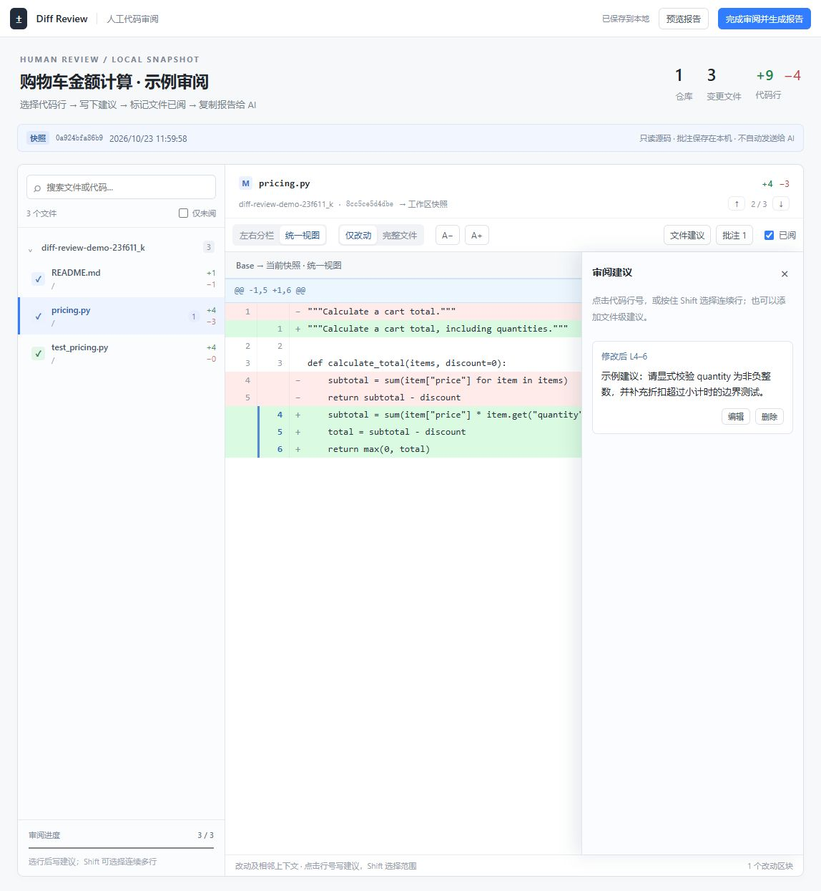

# Diff Review · Diff 审阅工具

**让 AI 给你一个审阅链接。你看 diff、选行写建议，最后把报告复制回去。**

A local, human-led Git diff reviewer packaged as a Codex plugin. No API key, no cloud backend, no third-party runtime dependencies.



## 使用流程

安装插件后，在任意项目对 Codex 说：

> 通过 diff 审阅工具方式让我审阅本次修改，给我链接。

1. Codex 确定本次修改的仓库、基线和文件范围，给出本地链接。
2. 打开页面，切换 **左右分栏 / 统一视图**、**仅改动 / 完整文件**。
3. 点击旧版或新版的行号写建议；按住 **Shift** 再点另一行可选范围。也支持文件级建议、编辑、删除批注。
4. 检查完一个文件，勾选 **已阅**。批注与进度自动保存在本机。
5. 所有文件已阅后，点击 **完成审阅并生成报告**，填写整体意见和结论。
6. 点击 **复制报告给 AI**，粘贴回原来的对话。也可下载 Markdown。

未完成时可以预览报告，但报告会明确写“部分审阅”，不会伪装为完整审核。工具不会自动改代码、提交 PR，或把报告发给任何模型。

## 安装为 Codex 插件

需要本地 **Python 3.10+、Git**，以及支持插件的 Codex。Windows、macOS、Linux 均使用同一个 Python 标准库实现。浏览器使用原生 JavaScript，不需要 npm install。

```sh
codex plugin marketplace add CastaneaG/codex-diff-review
codex plugin add diff-review@castaneag-tools
```

安装后新建对话，或刷新插件列表。可自然语言调用，也可显式使用 `$diff-review`。

如果所用 Codex 版本没有 `plugin add` 命令，添加 marketplace 后，在桌面应用的插件目录中选择 **CastaneaG Tools** 并安装 **Diff Review**。

这是 GitHub 分发的开源插件，不代表已上架官方公共插件目录。包装方式遵循 [OpenAI 插件文档](https://developers.openai.com/plugins/build/plugins)，提供 portable manifest 和 `.codex-plugin/plugin.json` 兼容布局。

## 不安装插件也能用

```sh
git clone https://github.com/CastaneaG/codex-diff-review.git
cd codex-diff-review
python skills/diff-review/scripts/review.py start --repo /path/to/project --title "本次修改"
```

macOS/Linux 若没有 `python` 命令，请使用 `python3`。Windows 路径包含空格时用引号包住。命令输出 JSON，其中 `url` 就是审阅链接。服务自动在后台启动，仅监听 `127.0.0.1`。

### 选择比较范围

```sh
# HEAD → 当前工作区，含已暂存、未暂存、未忽略的新文件
python skills/diff-review/scripts/review.py start --repo /path/to/repo

# 指定基线 → 当前工作区（包含任务期间已提交的修改）
python skills/diff-review/scripts/review.py start --repo /path/to/repo --base <starting-commit>

# 只看暂存区
python skills/diff-review/scripts/review.py start --repo /path/to/repo --staged

# 两个已提交版本之间的 diff
python skills/diff-review/scripts/review.py start --repo /path/to/repo --base main --head feature

# 只包含当前任务的文件
python skills/diff-review/scripts/review.py start --repo /path/to/repo --path src --path tests
```

`--base main --head feature` 比较两个版本的最终内容；如果需要 PR 风格的变化，请先用 `git merge-base main feature` 求出基线，再作为 `--base` 传入。

### 多仓库 / 子模块

可以重复 `--repo`，也可以用不同基线的清单：

```json
[
  {"path": "/work/app", "base": "main", "name": "Application", "paths": ["src", "tests"]},
  {"path": "/work/library", "base": "develop", "name": "Library"}
]
```

```sh
python skills/diff-review/scripts/review.py start --manifest /tmp/review-repos.json --title "跨仓库修改"
```

Git 根仓库只展示 submodule 指针变化；要审阅子模块内代码，请把子模块作为单独仓库加入清单。

### 恢复、停止

```sh
python skills/diff-review/scripts/review.py resume --session <session-directory>
python skills/diff-review/scripts/review.py stop --session <session-directory>
```

首次启动会输出 `session` 路径。默认数据目录是 `~/.codex-diff-review/sessions`；可通过 `--session-root` 更改。停止服务保留会话，恢复时批注与进度仍在，链接端口可能改变。关闭浏览器标签页不会停止服务。

## 报告与快照

报告包含：完整/部分审阅状态、结论、整体意见、仓库基线、文件路径、修改前/后行范围、批注、对应代码摘录，以及文件内容 SHA-256。

页面是**冻结的快照**。源码后续发生变化时应生成新链接，不会把旧批注自动挪到新行上。新快照不会继承旧快照的“已阅”。多页面同时写入同一会话会检测版本冲突，避免后写的页面无声覆盖前一个。

## 范围与限制

- 不联网传代码；不含模型调用、遥测或 CDN。公开的是工具源码，项目快照始终留在本机。
- 会话链接含随机访问标识；任何拿到该链接并能访问本机端口的人都能读取快照。不要分享敏感项目的会话链接。
- 默认采集所选范围的 tracked 变化和非 ignored 新文件；生成前请确认范围。不会自动扫描其他项目。
- UTF-8 文本支持完整内容；二进制、非 UTF-8、超过 1 MiB 或 12000 行的文件明确显示为元信息，需要另用合适工具检查，仍可填写文件级建议。
- 重命名目前显示为删除与新增；不做语义 diff。
- 当前项目需至少有一个可用提交作为比较基线。
- 是本机工具；远程主机执行时，需在该主机浏览器打开或自行建立本地端口转发。

## 开发和验证

```sh
python -m unittest discover -s tests -v
python scripts/create_demo.py
```

第二条命令在系统临时目录创建一个普通购物车示例 Git 仓库，不写入当前仓库。把输出路径传给 `review.py start --repo` 即可演示。CI 覆盖 Windows、Linux、macOS 的 Python 3.10 / 3.13。

```text
src/diff_review/       Git 快照、会话服务、报告、CLI
web/                  无构建依赖的浏览器界面
skills/diff-review/    Codex 自然语言入口与启动脚本
.agents/plugins/      GitHub marketplace 清单
.codex-plugin/        Codex 兼容插件清单
tests/                Git、行号、报告和本地服务测试
```

## License

[MIT](LICENSE). Copyright © 2026 CastaneaG.
